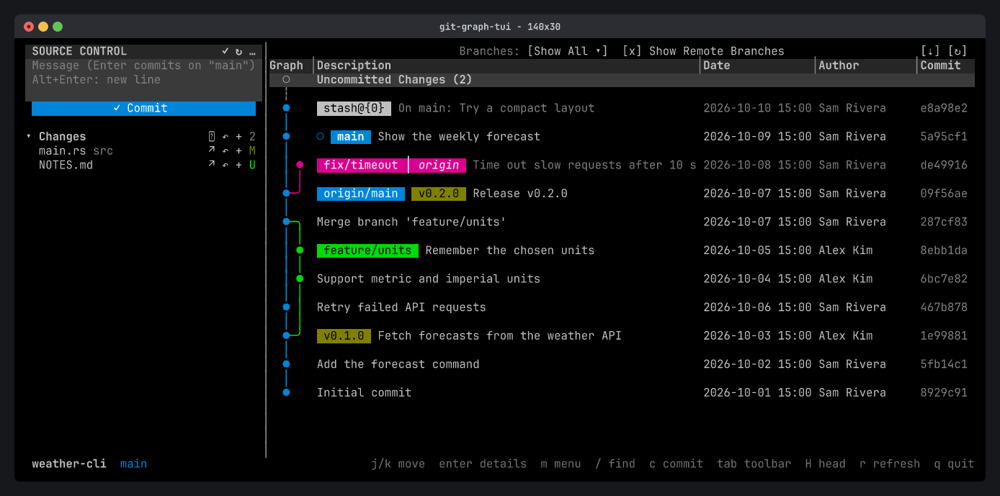
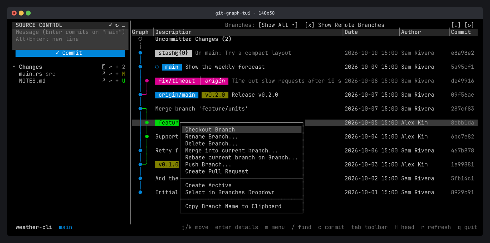
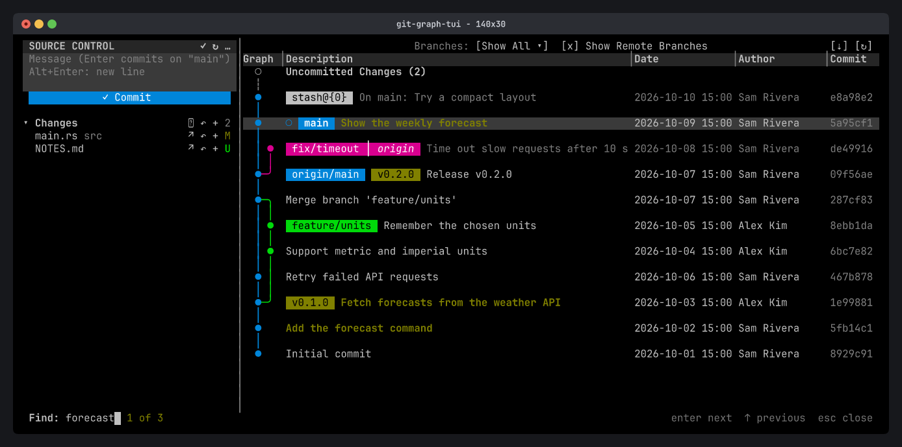
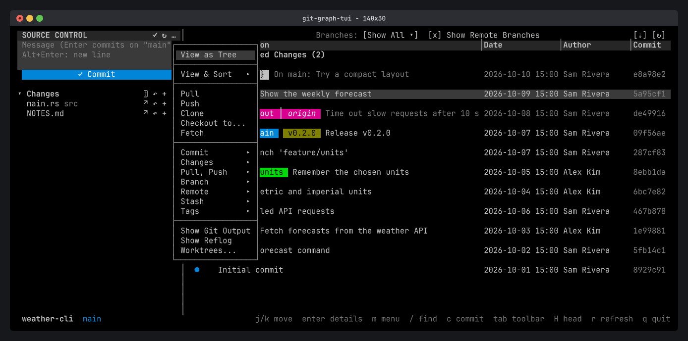

# git-graph-tui

[](https://github.com/allient/git-graph-tui/releases/latest)
[](https://github.com/allient/git-graph-tui/actions/workflows/ci.yml)
[](LICENSE)
[](https://ratatui.rs)

A Git Graph for your terminal: see every branch, tag and stash as a colored graph, and act on it with a right-click 🌳



**[Documentation](https://git-graph-tui.allient.io)** · **[Install](#installation)** · **[Releases](https://github.com/allient/git-graph-tui/releases)**

## About

git-graph-tui brings the [Git Graph extension for VS Code](https://github.com/mhutchie/vscode-git-graph) to the terminal. It is one native binary that works in any terminal, over SSH, in tmux, and in [herdr](https://herdr.dev/) panes.

### Why?

Terminal git tools make you choose. Some draw a beautiful graph but are read-only. Others manage git well, but their graph is an afterthought. Git Graph for VS Code is loved because it does both: you **see** the whole repository at a glance and **act** on it right where you look. git-graph-tui does the same, without leaving the terminal.

### Features

- **A clear graph.** Colored lanes, branch, tag and stash badges, and uncommitted changes at the top. Commits that aren't part of HEAD are muted.
- **Right-click anything.** Checkout, merge, rebase, cherry-pick, revert, reset, push, pull, tag, create a pull request, and more.
- **Mouse and keyboard.** Click, double-click, right-click and scroll, or do everything from the keyboard.
- **Source Control pane.** Stage, unstage, discard and commit, with amend and sign-off, like in VS Code.
- **Commit details.** Changed files as a tree with `+/-` counts, a built-in diff viewer, or your own pager (`delta`) or difftool.
- **Power tools.** Interactive rebase, conflict banner with continue and abort, reflog recovery, worktrees, compare commits.
- **Safe.** Every destructive action asks first and says exactly what will happen.
- **Fast and simple.** Loads history in pages and never blocks the UI. Its only dependency is `git`.

| Context menus | Commit details |
| --- | --- |
|  |  |
| **Find** | **Repository menu** |
|  |  |

## Installation

Prebuilt binaries for macOS, Linux and Windows are on every [release](https://github.com/allient/git-graph-tui/releases).

```sh
# Homebrew (macOS, Linux)
brew install allient/tap/git-graph-tui

# Shell installer (macOS, Linux)
curl --proto '=https' --tlsv1.2 -LsSf https://github.com/allient/git-graph-tui/releases/latest/download/git-graph-tui-installer.sh | sh
```

```powershell
# Windows (PowerShell)
powershell -ExecutionPolicy Bypass -c "irm https://github.com/allient/git-graph-tui/releases/latest/download/git-graph-tui-installer.ps1 | iex"
```

It needs `git` on your `PATH`. To build it yourself, see [Build from source](#build-from-source).

## Usage

Run it inside a git repository, or give it a path:

```sh
cd <your git repository>
git-graph-tui

git-graph-tui ~/code/my-project
```

```
Usage: git-graph-tui [OPTIONS] [PATH]

Arguments:
  [PATH]  Path inside the repository to open [default: .]

Options:
      --icons <STYLE>  Toolbar icons: VS Code's icons from a Nerd Font, or plain Unicode [possible values: auto, unicode, nerd]
  -h, --help           Print help
  -V, --version        Print version
```

### Keys

| Key / mouse | Does |
| --- | --- |
| `j` `k` / arrows | Move the selection |
| `Enter` / click | Open the commit's details |
| `m` / right-click | Context menu for the commit, branch, tag or stash |
| Double-click a branch | Check it out |
| `/` | Find commits by message, author, date, hash or ref |
| `c` | Go to the Source Control pane to stage and commit |
| `Tab` | Go to the toolbar (branch filter, remotes, refresh, fetch) |
| `H` | Jump to HEAD |
| `r` | Refresh |
| `q` | Quit |

The bottom bar always shows the main keys. See the [keys reference](https://git-graph-tui.allient.io/reference/keys/) for everything else.

### Config

Settings live in `~/.config/git-graph-tui/config.toml`, and the file is optional. Pane and column sizes are saved for you when you quit. See [configuration](https://git-graph-tui.allient.io/reference/configuration/) for icons, the diff pager and issue links.

## Documentation

- [Documentation site](https://git-graph-tui.allient.io): guides with screenshots for the graph, context menus, commit details and Source Control.
- [docs/usage.md](docs/usage.md): every key, mouse action and config option in one page.
- [docs/features.md](docs/features.md): the full feature checklist and roadmap.
- [docs/architecture.md](docs/architecture.md): goals, tech stack and how the code is organized.
- [herdr integration](integrations/herdr/README.md): open git-graph-tui in a herdr tab.

## Build from source

Requires Rust (`rustup` installs the pinned toolchain automatically) and `git`.

```sh
git clone https://github.com/allient/git-graph-tui.git
cd git-graph-tui
cargo run -- ~/code/my-project       # run it
cargo install --path crates/app      # or put git-graph-tui on your PATH
```

Want to help? See [CONTRIBUTING.md](CONTRIBUTING.md) for tests, linting, the docs site and releasing.

## Inspiration

| Project | Why it matters |
| --- | --- |
| [mhutchie/vscode-git-graph](https://github.com/mhutchie/vscode-git-graph) | The reference experience: a graph plus actions from right-click menus. |
| [lusingander/serie](https://github.com/lusingander/serie) | A beautiful Rust and ratatui commit graph for the terminal. |
| [git-bahn/git-graph](https://github.com/git-bahn/git-graph) | Rust CLI with a very clean lane layout. |
| [git-bahn/git-igitt](https://github.com/git-bahn/git-igitt) | Interactive TUI for browsing history and diffs. |
| [the0807/git-graph-plus](https://github.com/the0807/git-graph-plus) | Ideas for interactive rebase, reflog and worktrees. |

## License

MIT. git-graph-tui is **inspired by** Git Graph for VS Code but contains **no code from it**; the extension has its own license. All implementation is original.
