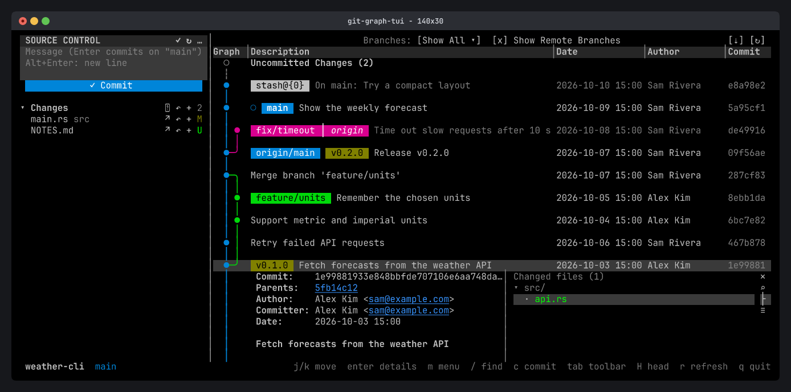

Press `Enter` (or click) on a commit to open its details under it: the full hash, parents, author, committer, date and message, and the files it changed. Press `Enter` again, or `Esc`, to close them.

## Files and diffs

- `j` `k` pick a file, `Enter` opens its diff, and `v` shows the whole file as it was in that commit.
- In a diff, `s` switches between one column and side by side (needs at least 100 columns).
- `t` opens the file in your `git difftool`.
- `f` filters the files by name, and `l` switches between a folder tree and a flat list.
- `J` `K` (or the mouse wheel) scroll the message and fields.

To pipe diffs into a pager such as [delta](https://github.com/dandavison/delta), set `[diff] pager` in the [config file](/reference/configuration/).

## Issue links

Issue references in the message, such as `#123`, are underlined. Click one to open the issue on origin's GitHub, GitLab or Bitbucket page, or on the page set by `[issues] url`.

## Compare commits

In the commit menu, **Select for Compare** marks a commit. On another commit, **Compare with Selected** lists the files changed between the two, and **Compare with Working Tree** lists what changed since the commit, uncommitted edits included.
