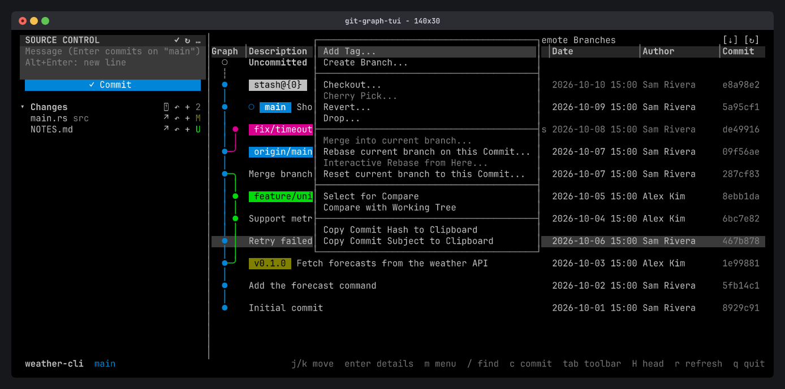
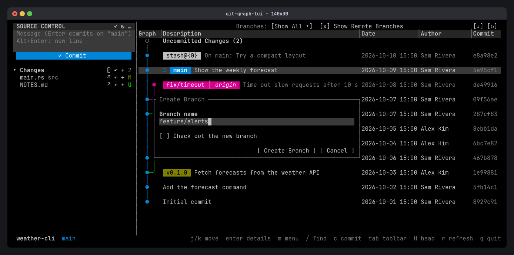

Right-click anything in the graph to see what you can do with it. From the keyboard, press `m` (or `Shift+F10`) to open the menu of the selected row.

## Branch menu

Right-click a branch badge to check it out, rename or delete it, merge it into the current branch, rebase onto it, push it, or open a pull request.

A remote branch's menu also has **Delete Remote Branch...**, **Pull into current branch...** and **Fetch into local branch...**, which updates a local branch without checking it out.

## Commit menu

Right-click a commit to:

- **Add a tag** or **create a branch** at it.
- **Check it out**, **cherry-pick**, **revert** or **drop** it.
- **Merge** it, **rebase** onto it, start an **interactive rebase** from it, or **reset** the current branch to it.
- **Compare** it with another commit or with your working tree.
- **Copy** its hash or subject.

Entries that don't apply are grayed out. For example, Cherry Pick is off for a commit that is already on the current branch.

With `m` on a row that has badges, each branch, remote branch and tag on it gets its own submenu (`Branch main ▸`) above the commit's entries.

## Tags and stashes

- **Tag menu:** view details, delete the tag (locally or on a remote), create an archive, copy its name.
- **Stash menu:** apply, pop or drop the stash, or create a branch from it.

## Dialogs

Actions that need input open a dialog. Type in the text fields, press `Space` to toggle a checkbox, `Tab` to move, and `Enter` to confirm. `Esc` cancels.

Every destructive action (hard reset, deleting a branch or tag, force push, dropping a stash or commit) asks first and says exactly what will happen. The safer option is the default: `--force-with-lease` over `--force`, and `reset --mixed`.

## Conflicts

When a merge, rebase, cherry-pick or revert stops on a conflict, a banner under the toolbar says so and counts the conflicted files. Resolve them and stage them, then press `C` to continue or `A` to abort (or click the banner's `[Continue]` and `[Abort]`).
